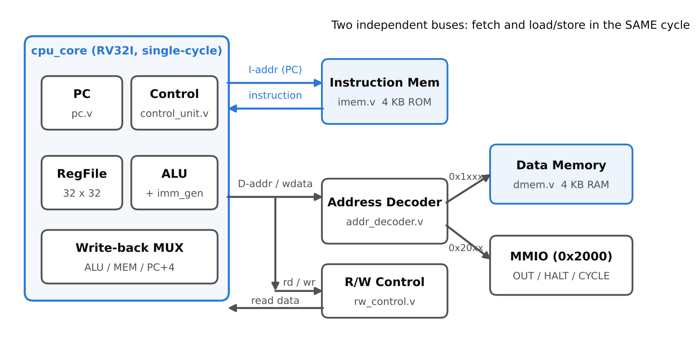

# Instruction and Data Memory Hierarchy
### Harvard-style memory organisation in Verilog vs. a shared (Von Neumann) memory
**Modern Computer Architecture · Project 9 · Phase I** — B.Tech CSE (AI), Rishihood University

| Member | Roll no. | Area |
|---|---|---|
| Aaryan Yadav | 2401010011 | Processor core (PC, register file, ALU, imm-gen, control unit) |
| Shashwat Sinha | 2401010438 | Instruction memory, assembler + golden model, test programs |
| Shivam Mishra | 2401010442 | Data memory, address decoder, read/write control, I/O, Harvard top |
| Himank Kaushik | 2401010187 | Von Neumann baseline (unified memory + arbiter), performance counters |
| Satyam Kumar | 2401010429 | Testbenches, regression, figures, report, video |

## Phase I deliverables
- 📄 **IEEE report:** [`report/report.pdf`](report/report.pdf) (LaTeX source: `report/report.tex`)
- 🎬 **Prototype / demo video (4:23):** [Google Drive folder](https://drive.google.com/drive/folders/14Je4C88HR8rfBHi4rCPuFqjwZodnTB22?usp=sharing)
- 💻 **Prototype:** all RTL, testbenches, programs and scripts below

## Idea in one paragraph
A CPU must **fetch instructions** and **load/store data**. With one shared memory (Von Neumann), a
load/store and the next fetch compete for the single bus, so the CPU stalls. With separate
instruction and data memories (Harvard), both happen in the same cycle. We built both around the
**same** single-cycle RV32I-subset core and measured the difference with hardware counters.



## Results (simulation)
| Program | Instr. | ld/st share | Harvard cycles | Von Neumann cycles | VN CPI | Speed-up |
|---|---:|---:|---:|---:|---:|---:|
| fibonacci | 128 | 1.6 % | 128 | 130 | 1.02 | 1.02× |
| array_sum | 176 | 19.9 % | 176 | 211 | 1.20 | 1.20× |
| bubble_sort | 633 | 31.1 % | 633 | 830 | 1.31 | 1.31× |
| vector_add | 156 | 31.4 % | 156 | 205 | 1.31 | 1.31× |

Harvard CPI = 1.00; Von Neumann CPI = 1 + f<sub>mem</sub>. All runs self-check against a Python golden
model, and every hardware cycle count matches that model exactly.


## Repository layout
```
rtl/            Verilog RTL
  defines.vh        address map + opcodes
  pc.v              program counter
  imem.v            4 KB instruction memory (ROM)
  dmem.v            4 KB data memory (RAM)
  addr_decoder.v    data-side address decoder
  rw_control.v      read/write control + read-data mux
  io_regs.v         memory-mapped I/O (OUT, HALT, CYCLE)
  regfile.v alu.v imm_gen.v control_unit.v cpu_core.v   single-cycle RV32I-subset core
  perf_counters.v   cycle / fetch / data-access / overlap counters
  harvard_top.v     PROPOSED: split instruction + data paths
  unified_mem.v     single-port memory for the baseline
  vonneumann_top.v  BASELINE: one shared memory + fetch/data arbiter
tb/             tb_top.v (self-checking, both designs), tb_addr_decoder.v (unit test)
sw/             rv32_asm.py (assembler + golden ISS), programs/*.s, build/ (generated)
sim/            run_all.sh (full regression), summarize.py
docs/           results.csv, make_figures.py, figures/
report/         IEEE report (LaTeX + PDF)
video/          VIDEO_LINK.md (demo video is on Google Drive)
```

## How to run
Requirements: `iverilog`, `python3` (+ `matplotlib`, `vcdvcd` for figures).
```bash
./sim/run_all.sh                 # assemble, simulate both designs, self-check, print table
python3 docs/make_figures.py     # regenerate waveforms + charts (needs sim output)
gtkwave sim/out/vector_add_harvard.vcd   # inspect any waveform
```
Supported instructions: ADD SUB AND OR XOR SLT SLL SRL, ADDI ANDI ORI XORI SLTI SLLI SRLI,
LW SW, BEQ BNE BLT BGE, JAL JALR, LUI (+ pseudo `li la mv j nop halt`).

## Phase II (planned)
Shared lower-level memory behind the split paths (modified Harvard), multi-cycle main-memory
latency and AMAT, synthesis (resources + Fmax), more benchmarks.
