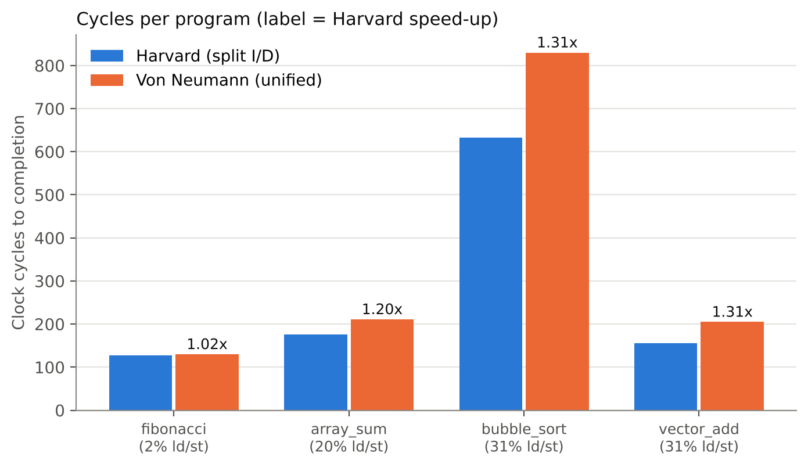
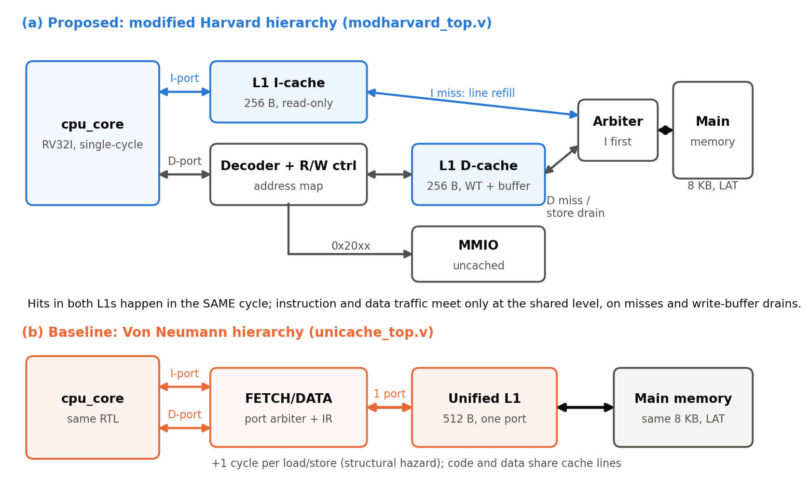
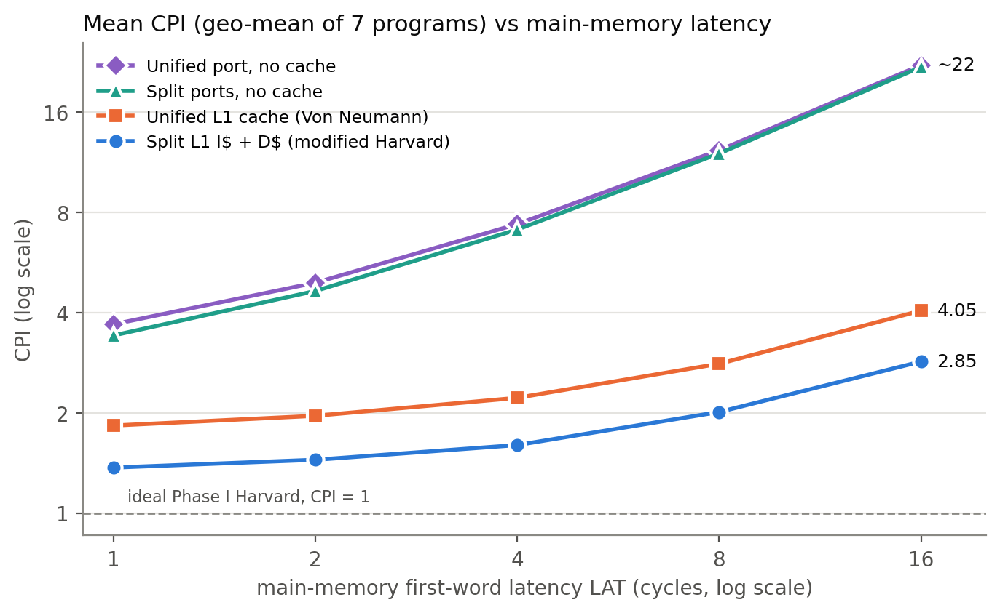
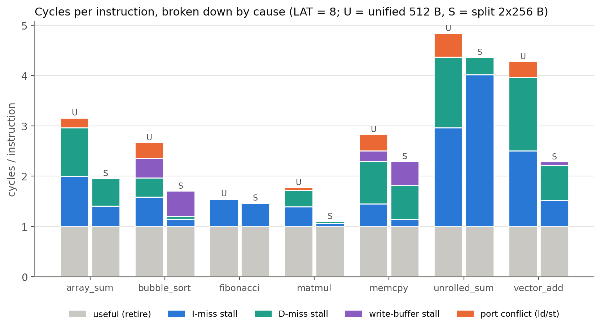
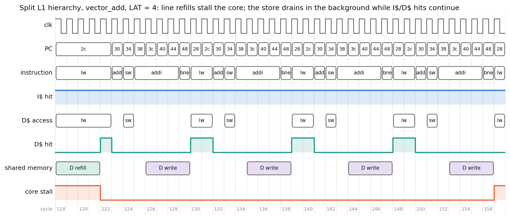

# Instruction and Data Memory Hierarchy
### Harvard-style memory organisation in Verilog vs. a shared (Von Neumann) memory
**Modern Computer Architecture · Project 9 · Phase I + Phase II** — B.Tech CSE (AI), Rishihood University

| Member | Roll no. | Phase I | Phase II |
|---|---|---|---|
| Aaryan Yadav | 2401010011 | Processor core (PC, register file, ALU, imm-gen, control unit) | Core stall interface, `modharvard_top` integration, synthesis flow |
| Shashwat Sinha | 2401010438 | Instruction memory, assembler + golden model, test programs | ISS access trace, golden cache model, 3 new benchmarks |
| Shivam Mishra | 2401010442 | Data memory, address decoder, read/write control, I/O, Harvard top | L1 cache (I/D/unified, write buffer), uncached I/O fence |
| Himank Kaushik | 2401010187 | Von Neumann baseline (unified memory + arbiter), performance counters | Shared main memory, arbiter, unified-cache baseline, hierarchy counters |
| Satyam Kumar | 2401010429 | Testbenches, regression, figures, report, video | Hierarchy + cache testbenches, sweep script, Phase II figures, final report |

## Deliverables
- 📄 **Final IEEE report (Phase II):** [`report/final_report.pdf`](report/final_report.pdf) (source: `report/final_report.tex`)
- 📄 Phase I IEEE report: [`report/report.pdf`](report/report.pdf)
- 🎞️ Animated presentation (open in a browser): [`docs/presentation.html`](docs/presentation.html)

### Phase I deliverables
- 📄 **IEEE report:** [`report/report.pdf`](report/report.pdf) (LaTeX source: `report/report.tex`)
- 🎬 **Prototype / demo video (4:23):** [Google Drive folder](https://drive.google.com/drive/folders/14Je4C88HR8rfBHi4rCPuFqjwZodnTB22?usp=sharing)
- 💻 **Prototype:** all RTL, testbenches, programs and scripts below

## Idea in one paragraph
A CPU must **fetch instructions** and **load/store data**. With one shared memory (Von Neumann), a
load/store and the next fetch compete for the single bus, so the CPU stalls. With separate
instruction and data memories (Harvard), both happen in the same cycle. We built both around the
**same** single-cycle RV32I-subset core and measured the difference with hardware counters.


## Results (simulation)
| Program | Instr. | ld/st share | Harvard cycles | Von Neumann cycles | VN CPI | Speed-up |
|---|---:|---:|---:|---:|---:|---:|
| fibonacci | 128 | 1.6 % | 128 | 130 | 1.02 | 1.02× |
| array_sum | 176 | 19.9 % | 176 | 211 | 1.20 | 1.20× |
| bubble_sort | 633 | 31.1 % | 633 | 830 | 1.31 | 1.31× |
| vector_add | 156 | 31.4 % | 156 | 205 | 1.31 | 1.31× |

Harvard CPI = 1.00; Von Neumann CPI = 1 + f<sub>mem</sub>. All runs self-check against a Python golden
model, and every hardware cycle count matches that model exactly.



## Phase II: shared lower-level memory (memory hierarchy)
The brief's *optional shared lower-level memory* is now implemented: an 8 KB main memory
(`main_mem.v`) that holds code **and** data, with a configurable latency `LAT` and burst
reads. It is compared in four organisations built from the **same** core:

| Organisation | Top level | What it is |
|---|---|---|
| VN-flat | `unicache_top` (`NOCACHE=1`) | one port, no cache: the classic Von Neumann bottleneck |
| Split-flat | `modharvard_top` (`NOCACHE=1`) | split ports, no cache, one shared slow memory |
| Unified L1 | `unicache_top` | one 512 B single-ported cache for code + data |
| **Split L1 (proposed)** | `modharvard_top` | 256 B I-cache + 256 B D-cache + arbiter: **modified Harvard** |



Results at `LAT = 8`, 16-byte lines (cycles to completion, all runs self-checked):

| Program | Instr. | VN-flat | Split-flat | Unified L1 | **Split L1** | Split vs unified |
|---|---:|---:|---:|---:|---:|---:|
| array_sum | 176 | 2092 | 2056 | 556 | **351** | 1.58× |
| bubble_sort | 633 | 8291 | 8062 | 1689 | **1080** | 1.56× |
| fibonacci | 128 | 1291 | 1288 | 199 | **196** | 1.02× |
| matmul | 2596 | 27401 | 27240 | 4614 | **2872** | 1.61× |
| memcpy | 394 | 5221 | 5028 | 1119 | **908** | 1.23× |
| unrolled_sum | 549 | 8061 | 7802 | 2662 | **2405** | 1.11× |
| vector_add | 156 | 2041 | 1976 | 668 | **357** | 1.87× |
| **geo-mean CPI** | | 12.28 | 12.01 | 2.81 | **2.01** | **1.40×** |

* Splitting the ports **without** caches helps only 2–8 %: the shared slow memory is the bottleneck.
* Split L1 caches restore the Harvard benefit: I- and D-hits happen in the same cycle, code and
  data stop evicting each other, and the shared memory almost never sees both caches at once
  (≤ 1 arbiter conflict cycle per program). Miss rate 4.0 % vs 8.9 %, AMAT 1.64 vs 2.15 cycles.
* The gap grows with memory latency (CPI 2.85 vs 4.05 at `LAT = 16`).





Verification: 266 hierarchy runs (7 programs × latency / size / line-size sweeps) each pass
**(1)** the golden-image data check, **(2)** an *exact* match of every cache counter against the
independent cache model `sw/cache_model.py`, and **(3)** cycle accounting
(`cycles = instret + Σ stalls`); plus 11 directed cache/memory checks (`tb/tb_l1_cache.v`).
Synthesis (Yosys, Xilinx 7-series): split hierarchy 1676 LUT / 303 FF vs unified 1770 / 315
(`docs/synth.csv`).

## Repository layout
```
rtl/            Verilog RTL
  defines.vh        address map + opcodes
  pc.v              program counter
  imem.v            4 KB instruction memory (ROM)
  dmem.v            4 KB data memory (RAM)
  addr_decoder.v    data-side address decoder
  rw_control.v      read/write control + read-data mux
  io_regs.v         memory-mapped I/O (OUT, HALT, CYCLE)
  regfile.v alu.v imm_gen.v control_unit.v cpu_core.v   single-cycle RV32I-subset core
  perf_counters.v   cycle / fetch / data-access / overlap counters
  harvard_top.v     PHASE I PROPOSED: split instruction + data paths
  unified_mem.v     single-port memory for the baseline
  vonneumann_top.v  PHASE I BASELINE: one shared memory + fetch/data arbiter
  main_mem.v        PHASE II shared lower-level memory (latency LAT, burst reads)
  l1_cache.v        PHASE II direct-mapped L1 cache (I / D / unified, write buffer)
  mem_arbiter.v     PHASE II I-cache / D-cache arbiter for the shared memory
  hier_perf.v       PHASE II hierarchy counters (misses, stall causes, conflicts)
  modharvard_top.v  PHASE II PROPOSED: split L1 I$ + D$ over shared main memory
  unicache_top.v    PHASE II BASELINE: unified L1 cache over the same memory
tb/             tb_top.v (Phase I), tb_hier.v (Phase II), tb_addr_decoder.v, tb_l1_cache.v
sw/             rv32_asm.py (assembler + golden ISS + access trace), cache_model.py,
                programs/*.s (7 programs), build/ (generated)
sim/            run_all.sh (everything), summarize.py, run_hier.py (Phase II sweep)
synth/          run_synth.sh + parse_synth.py (Yosys)
docs/           results.csv, results_hier.csv, synth.csv, figures/, presentation.html
report/         report.tex/pdf (Phase I), final_report.tex/pdf (Phase II, final)
video/          VIDEO_LINK.md (demo video is on Google Drive)
```

## How to run
Requirements: `iverilog`, `python3`, `yosys` for synthesis.
```bash
./sim/run_all.sh                       # Phase I + Phase II regression and sweeps
./synth/run_synth.sh                   # synthesis -> docs/synth.csv
gtkwave sim/out/hier/vector_add_split_L4.vcd   # inspect a hierarchy waveform
```
Supported instructions: ADD SUB AND OR XOR SLT SLL SRL, ADDI ANDI ORI XORI SLTI SLLI SRLI,
LW SW, BEQ BNE BLT BGE, JAL JALR, LUI (+ pseudo `li la mv j nop halt`).
